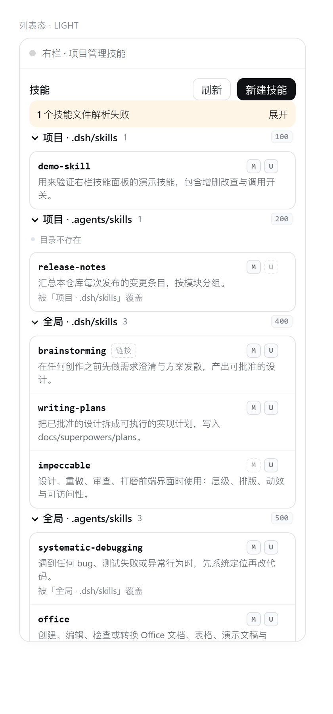
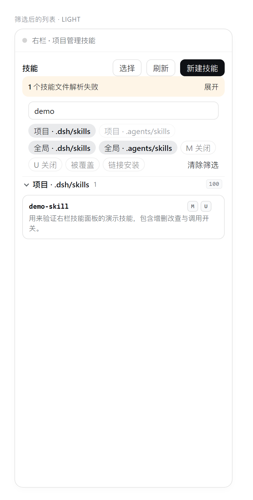
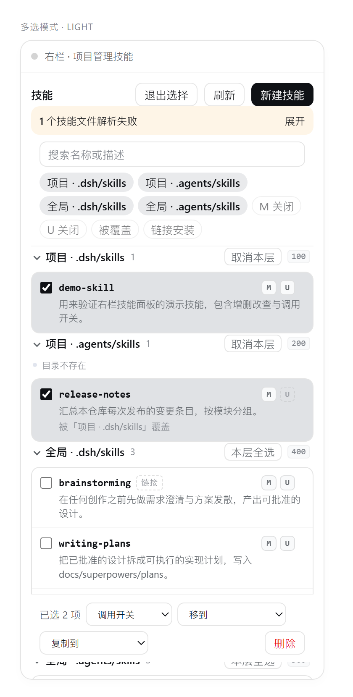
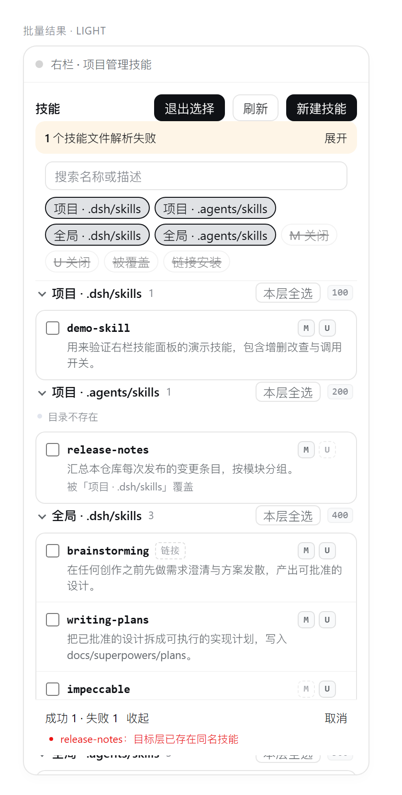
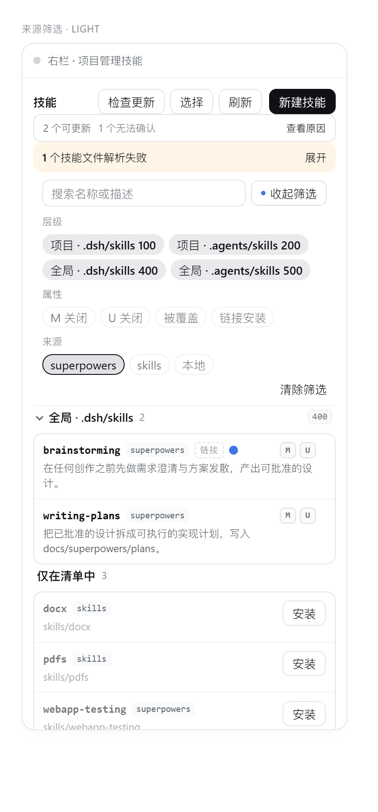
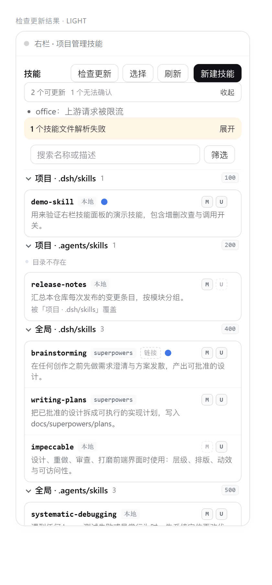

# dsh-project-skills-mng

[](https://github.com/MT3166/dsh-project-skills-mng/actions/workflows/test.yml)

在 DSH 右侧栏浏览与管理**项目级技能**（project skills）和**全局技能**（global skills）。

> 名字里的 `mng` = **management**：它不是"提供技能"的插件，而是**管理技能**的插件。
> 插件包名、GitHub 仓库名、右栏 tab id、Host API 路由（`/dsh-project-skills-mng/api`）
> 与 CSS 作用域统一使用 `dsh-project-skills-mng` 这一前缀。

DSH 原生已经会在会话里发现技能文件：项目技能位于 `<projectRoot>/.dsh/skills` 与
`<projectRoot>/.agents/skills`，全局技能位于 `~/.dsh/skills` 与 `~/.agents/skills`。
但这个发现过程对用户不可见，也没有 GUI 可以增删改。本插件补上这一层：

- 右侧栏 guide 页常驻入口「项目技能」，点开才展开面板，不会自己弹出来；
- 面板按 DSH 自己的四级发现顺序分级列出当前会话生效的技能（项目 `.dsh/skills`（100）→
  项目 `.agents/skills`（200）→ 全局 `~/.dsh/skills`（400）→ 全局 `~/.agents/skills`（500），
  数字越小越优先），每层显示路径、条目数、缺失/只读状态与优先级数字，可单独折叠；
- 每行显示模型可调用（M）/ 用户可调用（U）标记、链接安装（`~/.dsh/skills` 指向
  `~/.agents/skills` 的镜像）标记，以及同名的**被覆盖**条目；被覆盖的条目照样
  可以打开、编辑、删除——操作落在它自己所在的根上，不会动到胜出的那条同名技能；
- 支持新建、编辑、删除 `SKILL.md`，切换两个调用开关，frontmatter 校验与
  frontmatter 之外正文的原样保留；
- 筛选：名称/描述关键字、四个层级、只看 M 关闭、只看 U 关闭、只看被覆盖、
  只看链接安装，可叠加，筛选变化时不会对看不见的行执行操作；筛选 chip 默认折叠在
  「筛选」按钮后面，面板不会一开就占掉半屏；
- 来源：读 `~/.agents/.skill-lock.json`（`npx skills` 的清单），每行显示来源仓库
  （如 `obra/superpowers`）或「本地」，详情里给出仓库、仓库内路径、安装时间与短哈希，
  可按来源筛选；
- 检查更新 / 更新：对比上游 git tree sha（或内容哈希），有更新的行带小圆点，可单条或
  批量更新；更新走整包替换，旧版本留在 `.dsh-bak-<时间戳>-<名字>`，默认保留两份；
- 批量管理：工具栏「选择」进入多选模式，可批量删除、批量切换调用开关、
  跨层移动或复制（整包复制，`scripts/` 等支撑文件跟着走），结果逐条列出成功与失败原因；
- 同时注册一个 `skills_manage` 工具，让模型可以复用同一套读写逻辑。

清单里记录、但磁盘上已经不在的技能会单独列成「仅在清单中」分组，可一键重新安装
（只写 `~/.agents/skills`，与 `npx skills` 的行为一致，不会补建 `~/.dsh/skills` 的镜像链接）。

面板只读写技能文件本身，不重建技能注册表——DSH 的 `@deepseek-ai/dsh-skill-filesystem`
已经在监听这些目录，保存后模型侧会自动看到新内容。

## 安装

仓库地址：<https://github.com/MT3166/dsh-project-skills-mng>

```text
git clone git@github.com:MT3166/dsh-project-skills-mng.git
```

在 DSH 里安装克隆下来的目录（bundle 包）：

```text
plugin_manager action=install_bundle target=<本仓库绝对路径>
```

新装 bundle 由 HMR 直接生效；若是替换已安装的旧版本，需要重启 DSH 才会加载新的 JS。

## 面板

1. 会话打开右侧栏（`Ctrl+Shift+E` 一类的右栏开关），点「+」或 guide 页卡片
   「项目技能」；
2. 四个层级分组按优先级排列（100 / 200 / 400 / 500），点分组头折叠，点任意一行进入详情；
3. 详情里可以直接编辑 SKILL.md 正文与 frontmatter，保存后列表自动刷新；
4. 工具栏可以刷新与新建技能（名称 + 描述生成 frontmatter 模板，再手动补正文）；
5. 筛选：搜索框旁边点「筛选」展开三层 chip——层级（四个发现根，带优先级数字）、
   属性（M 关闭 / U 关闭 / 被覆盖 / 链接安装）、来源（每个上游仓库 + 「本地」），
   条件可叠加，「清除筛选」一键复原；收起后按钮上有个小圆点表示筛选仍在生效；
6. 工具栏「选择」进入多选：行前勾选框、组头「本层全选」、Shift 连选，Esc 退出；
   底部操作条可批量删除、批量切换调用开关、跨层移动或复制。结果条给出「成功 N · 失败 M」，
   失败项可展开看错误码（如目标层已有同名技能）；
7. 来源与更新：工具栏「检查更新」查询上游（GitHub API，5 分钟缓存），结果条给出
   可更新 / 无法确认的数量；有更新的行带小圆点，点进详情可「更新」或「强制更新」，
   多选模式里也能「更新选中」。

| 列表 | 筛选 |
| --- | --- |
|  |  |

| 多选 | 批量结果 |
| --- | --- |
|  |  |

| 来源筛选 | 检查更新结果 |
| --- | --- |
|  |  |

（截图由 `test/preview.mjs` 用真实主题 token 渲染，与 DSH 内的实际面板一致，只是外壳简化。）

## 安全边界

- 所有路径先过技能名白名单（`^[a-z0-9]+(?:-[a-z0-9]+)*$`），再做 realpath 校验，
  写操作只允许落在上述四个技能根目录内；
- 写入是 tmp 文件 + rename 的原子替换，且写前回读校验 frontmatter；
- 删除只作用于解析后的 `SKILL.md` 所在技能目录，UI 会二次确认；
- 跨层复制/移动整包进行（`scripts/` 等支撑文件一起走，`.git` 与 `node_modules` 不带过去），
  单包上限 32 MiB；移动是「先写目标、再删源」，删源失败会逐条报 `SOURCE_REMOVE_FAILED`；
- 更新只作用于清单里登记的上游技能：下载上限 64 MiB、解出后普通技能 32 MiB / 根级技能
  128 MiB，解包时校验 `..` 与 realpath；替换前比对本地快照，本地改过就报 `LOCAL_CHANGES`
  （要覆盖得显式「强制更新」），旧目录改名成 `.dsh-bak-<时间戳>-<名字>` 后新目录才就位，
  失败会回滚。

## 验证

- `test/host.test.mjs`（37 项）：假 ctx 覆盖 list 的四级 tier 与覆盖判定、按 rootId 读取被覆盖技能、
  write→read 往返、toggle 保留正文、平铺 `<name>.md` 原地覆盖、`skills_manage` 的
  create/update→write 映射、delete、非法名（`../escape`、`a/b`、`UPPER`、空名）、
  frontmatter 名不匹配、缺失根可写、未知会话返回 `SESSION_NOT_FOUND`、链接技能读写与只解除链接、
  跨层复制/移动（含整包复制、冲突、同层目标、覆盖失败时保留旧目标）、批量
  delete/invocation/transfer 与逐条失败、清单解析（全局 v3 / 项目 v1 版本门与专用错误码）、
  镜像链接合并成一行、missing 归组、checkUpdates 的 40 位 tree sha 与内容哈希两条比较路径、
  更新时保留未知字段与哈希格式、LOCAL_CHANGES/强更与备份、备份只保留两个且不误删同名前缀技能、
  内容未变时报告 up-to-date、tar 路径穿越、read 携带来源元数据。
- `test/client.smoke.mjs`（34 项）：模块表格式、tab 类型/guide 卡片注册、pane body 槽注册、
  zh/en key 对齐、样式注入与清理、空态零请求、相对 URL + sessionId、四级分组渲染（优先级数字、
  缺失/只读提示只在异常层出现）、详情→toggle→编辑→保存往返、新建模板、被覆盖行按自身 rootId
  读取/删除/编辑、筛选条与清除、选择模式与 Esc、筛选变化裁剪选中、本层全选只覆盖可见行、
  Shift 连选、批量 delete/move 请求体、部分失败展开、请求级错误条、筛选 chip 默认折叠与展开、
  按维度分行的三组 chip、来源 chip 单选收窄、检查更新结果条、批量更新请求体、missing 组安装、
  切换会话重置视图、项目清单行不提供更新动作、批量删除清空过期更新标记。
- `test/probe.mjs`：在真实 `~/.dsh/skills`、`~/.agents/skills` 上跑完整 list，得到
  `{project:1, global:24, total:25, shadowed:0, broken:0}`：20 条 `~/.dsh/skills` 镜像链接与
  `~/.agents/skills` 里的同名技能合并成一行，所以覆盖数为 0、总量为 25；清单里有 27 条记录、
  21 条可更新、6 条「仅在清单中」。
- 真实检查更新：对 27 条上游记录查询，得到 `{available:19, uptodate:7, unknown:1}`；
  真实更新过一条托管技能（`executing-plans`），旧版本备份到
  `~/.agents/skills/.dsh-bak-20261104093745-executing-plans`，清单里的 tree sha 与
  `updatedAt` 同步更新，未知字段原样保留。
- 真实 GUI：右栏 guide 卡片「项目技能」点开即面板，四层分级与链接标记显示正常。
- 仓库内 `.dsh/skills/demo-skill` 是验证用的项目技能样本，删掉不影响插件，也不在 npm `files` 里。

## 开发

```text
node --test test/host.test.mjs
node --test test/client.smoke.mjs
node test/probe.mjs
```

改面板样式时不必反复重启 DSH：`test/preview.mjs` 会用真实的主题 token（从
`@deepseek-ai/dsh-client-ui-theme` 抽出）与一个迷你 React 把 `client.js` 渲染成静态 HTML，
输出到 `test/preview-out/`（`list|detail|edit|create|empty` × `light|dark`），
再用本机 Edge/Chrome headless 截图查看效果：

```text
node test/preview.mjs
msedge --headless=new --disable-gpu --hide-scrollbars --force-device-scale-factor=2 ^
  --window-size=420,830 --user-data-dir=%TEMP%\edgeshot-list-light ^
  --screenshot=test\preview-out\list-light.png ^
  "file:///%CD%/test/preview-out/list-light.html"
```

- `index.js` — Host 半边：`/dsh-project-skills-mng/api` 路由（roots/list/read/write/delete/toggle、
  batch、transfer、checkUpdates、updateSkills）与 `skills_manage` 工具；
- `client.js` — Web 客户端半边：右栏 tab 类型、guide 卡片、面板 UI（模块表格式，
  React 由 DSH 浏览器侧提供）；
- `cordis.patch.yml` — 把 `dsh-project-skills-mng` 这一行插入 profile；
- `locale/{en,zh}.json` — bundle 的标题/描述；
- `docs/superpowers/plans/` — 设计与实现计划。

## 反馈

- 面板/Host API/工具出问题：用 [Bug 报告](https://github.com/MT3166/dsh-project-skills-mng/issues/new?template=bug_report.yml)；
- 想要新能力：用 [功能建议](https://github.com/MT3166/dsh-project-skills-mng/issues/new?template=feature_request.yml)。

## License

MIT © 2026 MT3166，见 [LICENSE](./LICENSE)。
